# Mind Palace — Improvement Spec + Fleet Work Partition

> The Mind Palace is the Notion-like wiki subgraph:
> `(:MindPalace)-[:HAS_PAGE]->(:Page)-[:HAS_BLOCK]->(:Block)`.
> This doc ranks concrete improvements, maps each to the exact module it lives in
> (post the `lib/palace/` refactor), gives its Cypher/graph shape, and partitions the
> work so ~8 agents each own a distinct file with minimal shared-file contention.
>
> **Graph is Sacred** governs every item below: a new *fact* is a node or an edge, never
> a scanned string property. **Modularization + APIRouter** govern the code: one seam =
> one `palace/*.py` module (composition + atomics) + a thin route.

Baseline to protect: `cyberneticircus/test_mind_palace.py` (19/19, no live neo4j —
`FakeDriver` records the Cypher each composition constructs). Every feature below adds
tests in that same style and keeps the suite green.

---

## 0. Post-refactor module map (the seams features drop into)

```mermaid
flowchart TB
    subgraph routers["routers/ (thin FastAPI facades — 1-line delegations)"]
        RMP["mind_palace.py<br/>(the 9 current routes)"]
        RNEW["palace_links.py · palace_search.py<br/>palace_history.py · palace_templates.py<br/>(NEW per-feature sub-routers)"]
    end
    subgraph libpalace["lib/palace/ (the domain package — impl)"]
        FAC["(lib/mind_palace.py = thin facade,<br/>re-exports palace/*)"]
        CRUD["crud.py<br/>hubs + pages lifecycle"]
        BLK["blocks.py<br/>:Block write path"]
        GR["graph.py<br/>export/import + graph-view"]
        LNK["links.py<br/>[[wiki-links]] + backlinks (STUB)"]
        SRCH["search.py<br/>full-text search (STUB)"]
        NEW["history.py · gate.py · templates.py<br/>transclude.py · blocktypes.py (NEW)"]
    end
    Graph[("neo4j<br/>:MindPalace/:Page/:Block")]

    RMP --> FAC
    RNEW --> FAC
    FAC --> CRUD & BLK & GR & LNK & SRCH & NEW
    CRUD & BLK & GR & LNK & SRCH & NEW --> Graph

    classDef stub fill:#332,stroke:#fa4;
    classDef new fill:#223,stroke:#4af;
    class LNK,SRCH stub
    class NEW,RNEW new
```



**Dependency rule (inward only):** `routers/ → lib/mind_palace (facade) → lib/palace/* → neo4j`.
No `palace/*` module imports a router; `crud._coerce_int` + `crud.*_CYPHER` are the shared
atoms other palace modules may import (see R9).

---

## 1. Ranked improvements

Ranked by value (impact on the wiki × how broken/limiting the current behavior is).

### R1 — Block-level edit + history/versioning (replace DETACH-DELETE full-replace) · **HIGH**
**Why:** `blocks.save_blocks` does `DETACH DELETE` every block then re-CREATEs the set on
every save. Consequences: block ids are non-stable (regenerated each save → breaks any
future backlink/transclude anchor), no edit history, and a concurrent save races the whole
page. Move to **per-block upsert by stable id** + a **revision trail**.
**Owner module:** `palace/blocks.py` (rewrite `save_blocks` to diff+upsert) + new
`palace/history.py` (the revision trail).
**Graph shape:**
```cypher
// stable-id upsert (block.id supplied by client, not regenerated)
UNWIND $blocks AS b
MERGE (blk:Block {id: b.id})
  ON CREATE SET blk.domain='cyberneticity', blk.subdomain='block'
SET blk.type=b.type, blk.content=b.content, blk.position=b.position,
    blk.level=b.level, blk.language=b.language
MERGE (p)-[:HAS_BLOCK]->(blk)
// then remove blocks no longer present (set-difference), and snapshot:
MERGE (p)-[:HAS_REVISION]->(rev:PageRevision {id:$rev_id, ts:$ts, subdomain:'revision', domain:'cyberneticity'})
```
**Collides-with:** owns `blocks.py`. R2 adds a 1-line `links.sync_page_links(...)` call inside
the new `save_blocks` (single integration point — coordinate with R2 owner). R4 is
type-agnostic here (types are stored, not special-cased).

### R2 — `[[wiki-links]]` + backlinks + backlinks panel · **HIGH**
**Why:** no way to link pages; no backlinks. The seam already exists as a stub
(`palace/links.py` with `parse_wiki_links` pure + `WIKI_LINK_RE`).
**Owner module:** `palace/links.py` (implement `sync_page_links`, `get_backlinks`) + new
`routers/palace_links.py` (GET backlinks route) + `static/app.js` (backlinks panel).
**Graph shape:** links are **edges**, not scanned props:
```cypher
// on save: reconcile outbound links from parsed [[Title]] tokens
MATCH (src:Page {id:$page_id})
OPTIONAL MATCH (src)-[old:LINKS_TO]->() DELETE old
WITH src UNWIND $targets AS title
  MATCH (dst:Page {title:title}) MERGE (src)-[:LINKS_TO]->(dst)
// backlinks panel
MATCH (src:Page)-[:LINKS_TO]->(p:Page) WHERE <id-match p> RETURN src.id, src.title
```
**Collides-with:** `blocks.save_blocks` (the one call site that triggers link-sync → coordinate
with R1). Otherwise isolated. Owns its router file → no `routers/mind_palace.py` contention.

### R3 — Full-text search across pages + blocks · **HIGH**
**Why:** no search; the workspace only navigates the tree. Seam stubbed
(`palace/search.py`).
**Owner module:** `palace/search.py` (`ensure_index`, `search_palace`) + new
`routers/palace_search.py` (GET search route) + `static/app.js` (search box).
**Graph shape:**
```cypher
CREATE FULLTEXT INDEX palace_fts IF NOT EXISTS FOR (n:Page|Block) ON EACH [n.title, n.content]
CALL db.index.fulltext.queryNodes('palace_fts', $q) YIELD node, score
MATCH (p:Page)-[:HAS_BLOCK*0..1]->(node) RETURN DISTINCT p.id, p.title, score ORDER BY score DESC
```
**Collides-with:** NONE (fully isolated backend + own router file). Lowest-risk, highest-value.

### R4 — Richer block types (toggle · callout · quote · table · image · embed · graph-block · kanban-block) + formalize `kv` · **MEDIUM-HIGH**
**Why:** only header/text/list/code/kv exist, and `kv` is undocumented in the API model
(the pydantic `BlockItem` in `routers/mind_palace.py` lacks it though DESIGN §5 and
`static/app.js` both use it — a live schema gap). Block storage is already type-agnostic
(`:Block {type, content, language, level}`), so most work is the **type registry + validation
+ frontend renderers**, not the write path.
**Owner module:** new `palace/blocktypes.py` (the canonical type enum + per-type validation of
`content`/`meta`) + `routers/mind_palace.py` (`BlockItem.type` → `Literal[...]`, add `meta` for
table/image) + `static/app.js` (renderers). Keep the backend type logic in `blocktypes.py`
so it does **not** touch `blocks.py`'s write path.
**Graph shape:** same `:Block`; rich types carry a `meta` JSON string prop
(`{"rows":[...]}` for table, `{"src":...,"alt":...}` for image). `graph-block`/`kanban-block`
reference a subgraph by id (a projection, resolved at render — see R6).
**Collides-with:** `routers/mind_palace.py` pydantic model (shared with the router owner),
`static/app.js` (shared frontend), and coordinates with R1 on the `content`/`meta` contract.

### R5 — Write-GATE tying palace writes to the Custodian genus · **MEDIUM**
**Why:** palace mutations (`crud`, `blocks`, `graph.import_palace`) call
`driver.session().run(...)` directly with hardcoded `domain:'cyberneticity'` — they **bypass**
the `lib.gates.validate_cypher_query` firewall (the :Wiki-write ban + domain/subdomain
whitelist) that the LLM-loop `query_database` path enforces. A hand-crafted import bundle can
write arbitrary labels. Add a palace-scoped warrant gate.
**Owner module:** new `palace/gate.py` — a `validate_palace_write(label, props)` /
`gated_run(session, query, params)` helper each write module opts into (one import-line +
one wrapped call per write site).
**Graph shape:** no model change — a validation layer. Reuse `lib.gates.validate_cypher_query`
+ the allowed-subdomain set (`page`, `block`, `mindpalace`, `revision`, …).
**Collides-with:** cross-cutting — touches `crud.py`, `blocks.py`, `graph.py` at one call site
each (coordinate: the gate owner adds the helper; each module owner adds the wrap, OR the gate
owner does all three in one pass). Owns `gate.py`.

### R6 — Graph-view integration (D3 "Island Districts") + graph-block · **MEDIUM**
**Why:** DESIGN §9 specifies Palace nodes rendered as cyan-halo hubs with Page/Block satellite
orbits on the D3 canvas; the projection query belongs with export.
**Owner module:** `palace/graph.py` (add `project_palace_islands(driver, mp_id)`) +
`lib/visualizer.py` + `static/app.js` (D3 render).
**Graph shape:**
```cypher
MATCH (mp:MindPalace) WHERE <id-match mp>
OPTIONAL MATCH (mp)-[:HAS_PAGE]->(p:Page) OPTIONAL MATCH (p)-[:HAS_BLOCK]->(b:Block)
RETURN mp, collect(DISTINCT p) AS pages, collect(DISTINCT b) AS blocks
```
**Collides-with:** owns `graph.py` (shares the file with export/import + R9 id-handling →
coordinate), `static/app.js`.

### R7 — Page templates + slash-command block insert · **MEDIUM**
**Why:** every page starts empty; no reusable structures; no fast block insert.
**Owner module:** new `palace/templates.py` (`list_templates`, `instantiate_template`) + new
`routers/palace_templates.py` + `static/app.js` (slash `/` menu).
**Graph shape:**
```cypher
(:PageTemplate {id, name, domain:'cyberneticity', subdomain:'template'})-[:TEMPLATE_BLOCK {position}]->(:Block)
// instantiate: copy the template's blocks onto a new/target Page
```
**Collides-with:** `crud.create_page` (optional `template_id` param → coordinate with crud
owner / R9), `static/app.js`. Owns its module + router file.

### R8 — Transclusion (embed a page/block inside another) · **LOW-MEDIUM**
**Why:** no reuse of content across pages; blocks can't reference other blocks/pages.
**Owner module:** new `palace/transclude.py` (resolve `transclude`-type blocks at read) +
a hook in `crud.get_page` + `static/app.js` (render embedded).
**Graph shape:**
```cypher
(:Block {type:'transclude', ref_id})-[:TRANSCLUDES]->(:Page|:Block)
// get_page resolves: for each transclude block, fetch the referenced content
```
**Collides-with:** `crud.get_page` (one resolution hook → coordinate with crud/R9 owner),
`static/app.js`. Owns `transclude.py`.

### R9 — Robust id handling (unify the triple-OR lookup; guard coercion) · **LOW (foundational)**
**Why:** every query repeats `elementId(x)=$id OR id(x)=$id_int OR x.id=$id`, and `int()` on a
non-numeric id was a latent crash (already hardened into `crud._coerce_int`). Promote the
match to a single shared clause so all modules stay consistent.
**Owner module:** `palace/crud.py` — export an `ID_MATCH_CLAUSE` constant + keep `_coerce_int`
as the one coercion atom; other modules import them.
**Collides-with:** foundational — do this **first** (or the crud owner owns it and others depend
on the exported constant). Touches `crud.py`; read-only for everyone else.

---

## 2. The fleet partition (≈8 agents, minimal contention)

**Design for de-collision:**
- **Backend = one feature → one `palace/*.py` module** → agents never collide on backend logic.
- **Routes = one NEW `routers/palace_<feature>.py` sub-router per feature**, each mounted by
  **one append-only `include_router(...)` line** in `web_server.py`. This leaves the original
  `routers/mind_palace.py` (the 9 routes) untouched except by R4 (the pydantic `BlockItem`).
- **`static/app.js` is the one unavoidable shared file** → treat frontend wiring as a **staged
  second pass** (backend is fully testable headless against the `FakeDriver` baseline with zero
  app.js changes). Partition app.js by non-overlapping function-region, or hand it to a dedicated
  integrator after backends land.

| # | Agent (feature) | Owns (primary file) | Also touches | Collides-with |
|---|---|---|---|---|
| 1 | **Backlinks / wiki-links** (R2) | `palace/links.py` | `routers/palace_links.py` (new), `web_server.py` (+1 line), `app.js` (panel) | R1 (1-line save hook), app.js |
| 2 | **Full-text search** (R3) | `palace/search.py` | `routers/palace_search.py` (new), `web_server.py` (+1 line), `app.js` (box) | **none backend**; app.js |
| 3 | **Block history / versioning** (R1) | `palace/blocks.py` + `palace/history.py` | `routers/palace_history.py` (new), `web_server.py` (+1 line) | R2 hook, R4 content contract |
| 4 | **Rich block types + `kv` fix** (R4) | `palace/blocktypes.py` (new) | `routers/mind_palace.py` (`BlockItem` model), `app.js` (renderers) | router model, app.js, R1 contract |
| 5 | **Write-gate + id-handling** (R5+R9) | `palace/gate.py` + `crud.py` (`ID_MATCH_CLAUSE`) | 1 wrapped call each in `crud/blocks/graph` | crud/blocks/graph (1 line each) |
| 6 | **Graph-view / islands** (R6) | `palace/graph.py` (projection) | `lib/visualizer.py`, `app.js` (D3) | graph.py (export/import), app.js |
| 7 | **Templates + slash-insert** (R7) | `palace/templates.py` (new) | `routers/palace_templates.py` (new), `web_server.py` (+1 line), `crud.create_page`, `app.js` (slash menu) | crud (1 param), app.js |
| 8 | **Transclusion** (R8) | `palace/transclude.py` (new) | `crud.get_page` (resolution hook), `app.js` (render) | crud (1 hook), app.js |

**Contention hot-spots + mitigation:**
- `static/app.js` — touched by 1,2,4,6,7,8. **Mitigation:** stage frontend AFTER backends; each
  agent edits a distinct, labeled function region; or a dedicated frontend integrator owns the
  final wiring pass. Backends ship + test with zero app.js edits.
- `web_server.py` — agents 1,2,3,7 each append ONE `include_router` line → append-only, ~zero
  conflict.
- `palace/crud.py` — agents 5 (id clause), 7 (create_page param), 8 (get_page hook) each touch a
  different function → low. **Agent 5 lands R9 FIRST** so 7/8 build on the exported clause.
- `palace/blocks.py` — agent 3 only; agents 2 (save hook) + 5 (gate wrap) add one line each →
  coordinate one merge point with agent 3.

**Suggested sequencing:** land **R9 (agent 5's id clause)** and **R3 (agent 2, fully isolated)**
first; then R1 (agent 3) before R2's save-hook (agent 1); R4/R6/R7/R8 in parallel; frontend
(app.js) as the final integration pass.

---

## 3. Bugs found while mapping (record)

- **FIXED** — `routers/mind_palace.py` `create_mind_palace_endpoint` called the non-existent
  `lib_mind_palace.create_mind_palace` (typo; lib fn is `create_mindpalace`), so
  `POST /api/mindpalace` 500'd. Fixed in commit `21f54a1`; regression-guarded by
  `test_route_create_mindpalace_wires_to_create_mindpalace`.
- **OPEN (out of scope here)** — `lib/dispatcher.py` calls `mind_palace.list_mindpalaces_cypher()`
  / `list_pages_cypher()` / `get_page_cypher()` / `create_mindpalace_cypher()` — a
  tuple-returning `*_cypher()` API that **never existed** in `mind_palace` (the module exposes
  `*_CYPHER` string constants + `list_mindpalaces(driver)` functions). Those dispatcher handlers
  raise `AttributeError` if ever invoked. A fleet agent should either add the `*_cypher()`
  constructors to `palace/` or fix the dispatcher to use the real surface.
- **NOTE** — `BlockItem` (pydantic) omits `kv` and only comments 4 types, though `kv` is a
  canonical block type (DESIGN §5) used by `static/app.js`. Fold into R4.
- **NOTE (arch tension, flag for Isaac)** — the `lib/palace/` package (`palace/crud.py` etc.)
  follows `onion-architecture.md`'s "expand a domain into a package" shape, which the
  `cyberneticircus-architecture.md` §0.0 "one module per level-2 dir" line reads against. The
  onion rule (detailed package structure) + the team-lead directive were taken as canonical here;
  worth reconciling the two rule files.
