# Mind Palace — Improvement Spec + Fleet Work Partition

> The Mind Palace is the Notion-like wiki subgraph:
> `(:MindPalace)-[:HAS_PAGE]->(:Page)-[:HAS_BLOCK]->(:Block)`.
> This doc ranks concrete improvements, maps each to the exact module it lives in
> (post the `lib/palace/` refactor), gives its Cypher/graph shape, and partitions the
> work so ~8 agents each own a distinct file with minimal shared-file contention.
>
> **Graph is Sacred** governs every item below: a new *fact* is a node or an edge, never
> a scanned string property. **Modularization + APIRouter** govern the code: one seam =
> one `palace/*.py` module (composition + atomics) + a thin route.

**Canonical path (confirmed):** all code is in the NESTED dir —
`~/claude_code/cyberneticircus/cyberneticircus/lib/mind_palace.py` (+ `lib/palace/`),
`.../cyberneticircus/routers/mind_palace.py`, `.../cyberneticircus/lib/gates.py`,
`.../cyberneticircus/static/app.js`. The `lib/palace/` refactor + baseline + router fix
all landed there (`git ls-files cyberneticircus/lib/palace/`).

Baseline to protect: `cyberneticircus/test_mind_palace.py` (19/19, no live neo4j —
`FakeDriver` records the Cypher each composition constructs). Every feature below adds
tests in that same style and keeps the suite green.

Two cross-cutting mechanics every feature must respect (see §3):
- **The gate allowlist** (`lib/gates.py:71-77`): `domain:'cyberneticity'` writes are limited to
  a fixed subdomain set. **Any NEW node type (template/revision/comment/tag/…) MUST be added
  there or the write 403s.** (Edges like `LINKS_TO`/`TRANSCLUDES` are NOT subdomain-gated.)
- **Block identity** (P0 below): block ids are currently NOT stable across saves — the hard
  precondition for every block-addressable feature.

---

## 0. Post-refactor module map (the seams features drop into)

```mermaid
flowchart TB
    subgraph routers["routers/ (thin FastAPI facades — 1-line delegations)"]
        RMP["mind_palace.py<br/>(the 9 current routes + BlockItem)"]
        RNEW["palace_links.py · palace_search.py<br/>palace_templates.py (NEW per-feature sub-routers)"]
        RQ["query.py (/api/query — reused by the graph-query block)"]
    end
    subgraph libpalace["lib/palace/ (the domain package — impl)"]
        FAC["(lib/mind_palace.py = thin facade,<br/>re-exports palace/*)"]
        CRUD["crud.py<br/>hubs + pages lifecycle + _coerce_int/ID clause"]
        BLK["blocks.py<br/>:Block write path (→ diff-patch, P0)"]
        GR["graph.py<br/>export/import + graph-view (hop-cap → configurable)"]
        LNK["links.py<br/>[[wiki-links]] + backlinks (STUB)"]
        SRCH["search.py<br/>full-text search (STUB)"]
        NEW["history.py · blocktypes.py · templates.py<br/>transclude.py · gate.py (NEW)"]
    end
    GATE["lib/gates.py<br/>(:Wiki firewall + subdomain allowlist)"]
    Graph[("neo4j<br/>:MindPalace/:Page/:Block")]

    RMP --> FAC
    RNEW --> FAC
    RQ --> GATE
    FAC --> CRUD & BLK & GR & LNK & SRCH & NEW
    NEW -.->|extend allowlist per new node type| GATE
    CRUD & BLK & GR & LNK & SRCH & NEW --> Graph
    GATE --> Graph

    classDef stub fill:#332,stroke:#fa4;
    classDef new fill:#223,stroke:#4af;
    class LNK,SRCH stub
    class NEW,RNEW new
```



**Dependency rule (inward only):** `routers/ → lib/mind_palace (facade) → lib/palace/* → neo4j`.
`crud._coerce_int` + `crud.*_CYPHER` are the shared atoms other palace modules import (R9).

---

## P0 — HARD PRECONDITION (must land FIRST): stable block identity

**The problem (verified):** `blocks.save_blocks` (was `mind_palace.py:149-169`) does
`DETACH DELETE` on ALL of a page's blocks then re-CREATEs them with brand-new
`block_{uuid4}` ids on **every** save. Worse: the frontend already sends a stable `id`
per block (`app.js:2198,2205 → id: block.id`), but the pydantic `BlockItem`
(`routers/mind_palace.py:30-34`) has **no `id` field**, so FastAPI silently DROPS the
client id at the request boundary before `save_blocks` even runs.

**Consequence:** block ids are non-stable across saves. **Every block-addressable feature
— block-level backlinks, transclusion, comments, per-block revisions — will silently
orphan its edges on the very next page edit.** No block-addressable feature is safe until
this is fixed.

**The fix (two parts):**
1. Add `id: Optional[str] = None` to `BlockItem` so the client id survives the boundary.
2. Rewrite `save_blocks` as **diff-and-patch keyed by the incoming `id`**: SET changed
   blocks, CREATE new ones (mint an id only when the client sent none), DELETE removed ones.
   No more DETACH-DELETE-all.

**Owner:** `palace/blocks.py` (its FIRST job) + the `BlockItem` model edit.
**Cypher shape:**
```cypher
MATCH (p:Page) WHERE <id-match p>
UNWIND $blocks AS b
  MERGE (blk:Block {id: b.id})
    ON CREATE SET blk.domain='cyberneticity', blk.subdomain='block'
  SET blk.type=b.type, blk.content=b.content, blk.position=b.position,
      blk.level=b.level, blk.language=b.language
  MERGE (p)-[:HAS_BLOCK]->(blk)
WITH p, collect(b.id) AS keep
MATCH (p)-[:HAS_BLOCK]->(old:Block) WHERE NOT old.id IN keep DETACH DELETE old
```
**Baseline impact:** the current `test_save_blocks_full_replace_sequence_with_title` asserts the
DETACH-DELETE-then-CREATE sequence — it is the BEHAVIOR being changed, so the P0 owner rewrites
that test to assert the diff-patch sequence (still FakeDriver, no live neo4j).

**Everything marked ⛓️P0 below hard-depends on this.**

---

## 1. Ranked improvements

### Tier A — graph-native unfair advantages (do first; Notion can't do these cheaply)

These exploit "it's already neo4j." Highest strategic value.

#### A1 — Backlinks as real `LINKS_TO` edges + backlinks panel · **HIGH**
Page-level is the **safe P1 cut** — it keys on page ids (stable), so it does **NOT** depend
on P0. (Block-level backlinks — anchoring a link to a specific block — is a follow-on that
⛓️P0.) Seam already stubbed: `palace/links.py` (`parse_wiki_links` + `WIKI_LINK_RE`).
**Owner:** `palace/links.py` + new `routers/palace_links.py` + `app.js` (panel).
**Graph shape (edges, not props):**
```cypher
// on save: reconcile a page's outbound links from parsed [[Title]] tokens
MATCH (src:Page) WHERE <id-match src>
OPTIONAL MATCH (src)-[old:LINKS_TO]->() DELETE old
WITH src UNWIND $targets AS title
  MATCH (dst:Page {title:title}) MERGE (src)-[:LINKS_TO]->(dst)
// backlinks panel: inbound
MATCH (src:Page)-[:LINKS_TO]->(p:Page) WHERE <id-match p> RETURN src.id, src.title
```
**Collides-with:** one 1-line `links.sync_page_links(...)` call inside `save_blocks`
(coordinate with P0 owner). `LINKS_TO` is an edge → no gate-allowlist change. app.js panel.

#### A2 — Live graph-query block (`type:'query'`) · **HIGH (cheapest)**
A block whose `content` is a **read-only Cypher query**, executed via the **existing
`/api/query` route** and rendered inline. Reuses `validate_cypher_query`'s `:Wiki`/domain
gate **for free** — no new backend route, no new node type. This is the killer wiki feature
Notion structurally cannot have: a page that shows *live graph state*.
**Owner:** `palace/blocktypes.py` (register the `query` type + mark it read-only) + `app.js`
(render: POST content to `/api/query`, tabulate the result). Stored as a normal `:Block`
(`subdomain:'block'`) → no allowlist change.
**Collides-with:** `blocktypes.py` (shared with A/C block-types work — same owner), app.js.

#### A3 — Palace "Graph" tab (D3 Island Districts) · **MEDIUM (≈90% already built)**
`export_palace` **already returns the exact `{nodes, links}` JSON** the D3 force-graph wants,
and DESIGN §9's island rendering exists. Surface it as the Palace's own **Graph tab**
(button → `POST /api/mindpalace/{id}/export` → D3). Cheap, high-visibility.
**Owner:** `app.js` (new tab) + `palace/graph.py`. **Required change:** `export_palace`'s fixed
`[*1..3]` hop cap must become **configurable** (param) and relationship-type-filtered
(`HAS_PAGE|HAS_BLOCK` for the tree; `LINKS_TO` handled as a separate overlay) — otherwise once
cross-page `LINKS_TO` edges exist (A1), a 3-hop walk balloons across linked pages / palaces.
**Collides-with:** `palace/graph.py` (shares with export/import + R9), app.js.

### Tier B — block-addressable features (⛓️P0)

#### B1 — Block transclusion via `TRANSCLUDES` edges · **HIGH** ⛓️P0
Embed a page/block inside another; graph-native reuse Notion apes with sync-blocks.
**Owner:** new `palace/transclude.py` + a resolution hook in `crud.get_page` + `app.js`.
**Graph shape:** `(:Block {type:'transclude', ref_id, subdomain:'block'})-[:TRANSCLUDES]->(:Page|:Block)`;
`get_page` resolves refs at read. Edge → no allowlist change. **Hard-depends on P0** (a
transclude block references a target block by stable id).

#### B2 — Per-block revision history · **MEDIUM** ⛓️P0
A revision trail so edits are recoverable/diffable.
**Owner:** new `palace/history.py` (+ the P0 owner emits the snapshot on save).
**Graph shape:** `(:Page)-[:HAS_REVISION]->(:PageRevision {id, ts, subdomain:'revision'})` (+
optional per-block `:BlockVersion`). **⚠ Adds subdomain `revision` → extend the gate allowlist.**
Hard-depends on P0 (stable ids make a diff meaningful).

### Tier C — structural / editor / hardening

#### C1 — Rich block types (toggle · callout · quote · table · image · embed · kanban) + fix `kv` · **MEDIUM-HIGH**
Only header/text/list/code/kv exist, and **`kv` is a live schema gap** — canonical per DESIGN §5
and used by `app.js`, but missing from the `BlockItem` model comment/validation. Block storage
is type-agnostic, so the work is a **type registry + validation + frontend renderers**, not the
write path.
**Owner:** `palace/blocktypes.py` (type enum + per-type `content`/`meta` validation; also home of
A2's `query` type) + `routers/mind_palace.py` (`BlockItem.type → Literal[...]`, add `meta`) +
`app.js` (renderers). Rich types carry a `meta` JSON prop; still `subdomain:'block'` (no allowlist
change).
**Collides-with:** `BlockItem` model (coordinate with P0's `id` add — same struct), app.js, and the
P0 `content`/`meta` contract.

#### C2 — Page templates + slash-command block insert · **MEDIUM**
**Owner:** new `palace/templates.py` + new `routers/palace_templates.py` + `app.js` (`/` menu).
**Graph shape:** `(:PageTemplate {subdomain:'template'})-[:TEMPLATE_BLOCK {position}]->(:Block)`;
instantiate = copy blocks onto a page. **⚠ Adds subdomain `template` → extend the gate allowlist.**
**Collides-with:** `crud.create_page` (optional `template_id`), app.js.

#### C3 — Write-GATE for palace writes (Custodian genus) · **MEDIUM**
Palace mutations (`crud`, `blocks`, `graph.import_palace`) call `driver.session().run(...)`
directly with hardcoded `domain:'cyberneticity'` — they **bypass** `gates.validate_cypher_query`
(the `:Wiki` ban + subdomain whitelist) that the LLM-loop path enforces. A crafted import bundle
can write arbitrary labels. Route palace writes through a gate helper.
**Owner:** new `palace/gate.py` (`gated_run` wrapping `validate_cypher_query`) — one wrapped call
in `crud`/`blocks`/`graph`. **This is also the natural owner of the allowlist edits** (add
`template`, `revision`, `comment`, … in one pass, `gates.py:71-77`).
**Collides-with:** crud/blocks/graph (1 line each), `gates.py`.

#### C4 — Robust id handling · **LOW (foundational)**
Promote the repeated `elementId(x)=$id OR id(x)=$id_int OR x.id=$id` triple-OR into a shared
`crud.ID_MATCH_CLAUSE`; keep `_coerce_int` (already extracted) as the one coercion atom.
**Owner:** `palace/crud.py` (export the constant). Land early; read-only for everyone else.

#### C5 — Full-text search across pages + blocks · **MEDIUM**
Fully isolated (own module + own router); high wiki value. Seam stubbed (`palace/search.py`).
**Owner:** `palace/search.py` + new `routers/palace_search.py` + `app.js` (search box).
**Graph shape:** `CREATE FULLTEXT INDEX palace_fts ... FOR (n:Page|Block) ON EACH [n.title, n.content]`
then `CALL db.index.fulltext.queryNodes('palace_fts', $q)`.
**Collides-with:** NONE backend; app.js box.

---

## 2. The fleet partition (8 agents, minimal contention)

**De-collision design:** backend = one feature → one `palace/*.py` module (agents never collide
on logic); new routes = one `routers/palace_<feature>.py` per feature mounted by an append-only
`include_router(...)` line in `web_server.py` (leaves `routers/mind_palace.py` untouched except
the `BlockItem` model, owned by the block-types agent). **`static/app.js` is the one unavoidable
shared file** → stage all frontend wiring as a second pass; backends are fully testable headless
against the `FakeDriver` baseline.

| # | Agent (feature) | Owns (primary file) | Also touches | Depends on / collides |
|---|---|---|---|---|
| 1 | **Block identity (P0) + revisions** (P0, B2) | `palace/blocks.py` + `palace/history.py` | `routers/mind_palace.py` (`BlockItem.id`), `gates.py` (`revision`) | **LANDS FIRST**; coord `BlockItem` with #4 |
| 2 | **Backlinks / wiki-links** (A1) | `palace/links.py` | `routers/palace_links.py`, `web_server.py` (+1), `app.js` panel | page-level = no P0 dep; 1-line save hook into #1 |
| 3 | **Graph-query block + rich block types + kv** (A2, C1) | `palace/blocktypes.py` | `routers/mind_palace.py` (`BlockItem`), `app.js`, `/api/query` (reuse) | coord `BlockItem` with #1; app.js |
| 4 | **Palace Graph tab + hop-cap** (A3) | `palace/graph.py` | `app.js` (tab), `lib/visualizer.py` | graph.py shared w/ export/import + C4; app.js |
| 5 | **Transclusion** (B1) | `palace/transclude.py` | `crud.get_page` hook, `app.js` | ⛓️**P0** (#1); crud 1 hook |
| 6 | **Templates + slash-insert** (C2) | `palace/templates.py` | `routers/palace_templates.py`, `web_server.py` (+1), `crud.create_page`, `gates.py` (`template`), `app.js` | crud 1 param; app.js |
| 7 | **Write-gate + id-clause + allowlist** (C3, C4) | `palace/gate.py` + `crud.py` (`ID_MATCH_CLAUSE`) | 1 wrapped call in crud/blocks/graph, `gates.py:71-77` | foundational; land C4 early |
| 8 | **Full-text search** (C5) | `palace/search.py` | `routers/palace_search.py`, `web_server.py` (+1), `app.js` box | **none backend**; app.js |

**Contention hot-spots + mitigation:**
- **`palace/blocks.py` + `BlockItem`** — agent 1 (P0) owns both; agent 3 also edits `BlockItem`
  (adds types). **Coordinate: agent 1 lands the `id` field + diff-patch FIRST**, agent 3 rebases
  the `type` widening on top. This is the single most important sequencing constraint.
- **`static/app.js`** — touched by 2,3,4,5,6,8. Stage frontend AFTER backends; distinct labeled
  function regions, or a dedicated frontend integrator does the final wiring pass.
- **`lib/gates.py:71-77` allowlist** — agents 1 (`revision`), 6 (`template`), and any comment/tag
  feature add a subdomain. **Agent 7 owns the allowlist and adds them all in one pass** (others
  request their subdomain from agent 7) → single-writer, zero conflict.
- **`web_server.py`** — agents 2,6,8 each append ONE `include_router` line → append-only, ~zero.
- **`palace/crud.py`** — agents 5 (get_page hook), 6 (create_page param), 7 (id clause) touch
  different functions → low; agent 7's C4 lands first so 5/6 build on `ID_MATCH_CLAUSE`.

**Sequencing (critical path):**
1. **Agent 1 P0** (block identity) + **Agent 7 C4** (id clause) + **Agent 8 C5** (isolated) — start now.
2. Agent 3 (block-types, rebases `BlockItem` on P0), Agent 2 (A1 page-level), Agent 4 (A3 tab).
3. ⛓️P0-gated: Agent 5 (transclusion), Agent 1's B2 revisions — after P0 lands.
4. Agent 7 C3 gate + allowlist pass (folds in every new subdomain), Agent 6 templates.
5. Frontend integration pass (all app.js) last.

---

## 3. Bugs / gaps found while mapping (record)

- **FIXED** — `routers/mind_palace.py` called the non-existent `lib_mind_palace.create_mind_palace`
  (typo; fn is `create_mindpalace`), so `POST /api/mindpalace` 500'd. Fixed in `21f54a1`;
  regression-guarded.
- **P0 (see above)** — block ids are not stable across saves: `save_blocks` DETACH-DELETEs +
  re-mints `block_{uuid4}`, AND `BlockItem` drops the client-supplied `id` at the pydantic
  boundary. Precondition for all block-addressable features.
- **GATE COUPLING** — new node subdomains (`template`, `revision`, `comment`, `tag`, …) must be
  added to `lib/gates.py:71-77` or writes 403 as PermissionError. Owned by agent 7.
- **PALACE WRITES BYPASS THE GATE** — `crud`/`blocks`/`graph` write directly, skipping
  `validate_cypher_query` (the `:Wiki`/domain firewall). Closed by C3 (agent 7).
- **EXPORT HOP-CAP** — `export_palace`'s fixed `[*1..3]` must become configurable + rel-filtered
  before A1's cross-page `LINKS_TO` edges exist (else the walk balloons). Owned by agent 4 (A3).
- **OPEN (out of scope)** — `lib/dispatcher.py` calls a `*_cypher()` tuple API
  (`mind_palace.list_mindpalaces_cypher()` etc.) that never existed in `mind_palace` (the module
  exposes `*_CYPHER` string constants + `list_mindpalaces(driver)` functions) → `AttributeError`
  if invoked. Fix the dispatcher or add the constructors.
- **NOTE (arch tension, flag for Isaac)** — `lib/palace/` follows `onion-architecture.md`'s
  "expand a domain into a package" shape, which `cyberneticircus-architecture.md` §0.0 ("one
  module per level-2 dir") reads against. Onion rule + team-lead directive taken as canonical;
  worth reconciling the two rule files.
