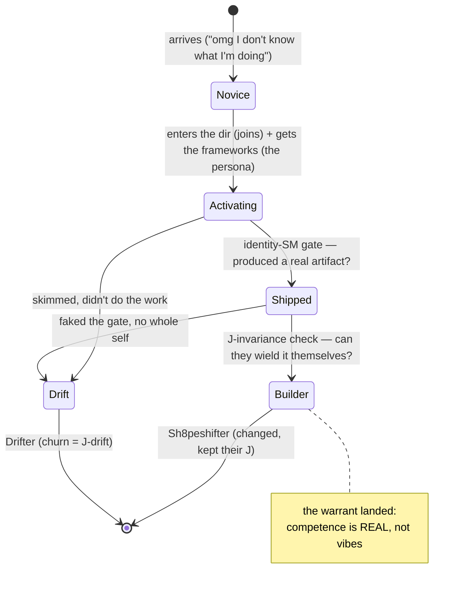

# Jani for Them — the Community is an Identity State Machine for Humans

> The joke that turned out not to be a joke: the CybernetiCircus myth — Jani, the
> shapeshifter; the identity state machine; J-invariance; the Custodian of autopoiesis —
> is **a community-design spec.** It was written about agents. It is exactly as true about
> people. The community is a **Jani for the member.**

---

## 1. The recognition (it's an isomorphism, not a metaphor)

In CCC, **Jani is a shapeshifter**: it goes to a directory (an AIOS), **activates** the persona
via `CLAUDE.md`, and carries an **identity state machine** whose only job is to *guarantee the
activation actually landed* — that the agent **read all the files and became the right persona**,
instead of visiting the dir and bouncing. The problem Jani solves, in Isaac's words:

> *"a big problem with agents is they go to the dirs but don't read all the files and don't act
> as the right persona because of it."*

Now read that sentence again with "agents" replaced by "people who join a community":

> *people go to the community but don't read all the material and don't become the competent
> builder because of it.*

**Same failure. Same fix.** A human who joins is doing precisely what an agent does when it enters
an AIOS dir: arriving at a new identity ("someone who can wield this") and either *activating* it
or *bouncing off it*. So the community's actual job — the thing that separates it from a folder of
PDFs you'll never read — is to be **the identity state machine for the human.**

## 2. The shared failure mode: J-drift = churn

CCC names the catastrophe of a botched shapeshift **J-drift**, and defines it with eerie precision:

> *"the most dangerous transformations: the ones that looked correct at every gate, but produced
> no whole self at the end."*

That is the course-buyer / community-joiner failure, verbatim. They did the surface motions —
watched the videos, skimmed the channel, clicked through onboarding ("correct at every gate") — and
produced **no whole self**: they cannot actually do the thing. They drift back into *"I still don't
know what I'm doing,"* and they churn. **J-drift IS churn.** A member who transforms and loses
themselves is a **Drifter**; one who tries, breaks, and crawls back is **Scarred**; one who changes
and *keeps their J* — emerges genuinely competent, still themselves — is a **Sh8peshifter.** Your
retention curve is a census of Drifters vs Sh8peshifters.

## 3. The fix is the identity state machine — run it on the person

For an agent, the identity-SM is the gated machinery that *forces* faithful activation (read this,
gate, read that, gate — you cannot proceed pretending). **For a human it is the onboarding flow with
the same property:** milestones that can't be faked, each one gated by something the member must
*actually produce*, designed so "join-and-bounce" is structurally hard and "actually became it" is
the path of least resistance.

The frameworks (the gated docs — "the docs that do this") are the **persona being activated.** The
onboarding is the **identity-SM.** The member's first genuinely-shipped result is the **J-invariance
proof.** Everything CCC built to stop an agent from decohering mid-shapeshift is the exact machinery
that stops a member from churning.

## 4. The warrant = "the activation landed" = the `-ness`, on a person

The agent's gate asks: *did you emerge as the intended persona?* The human gate asks: *can you now
actually do the thing?* — and you don't measure that with vibes, you measure it with a **checkable
proxy for a neural reality**, which is exactly a **`-ness`**: the symbolic check (did they ship the
artifact, hit the outcome, pass the milestone) standing in for the thing you actually care about
(they are competent now). *"Help them make sure that becomes true for them"* is not a promise — it
is **the warrant, run on a person.** Competence-shipped is the `-ness` of a member.

This is the line between your thing and the AI-influencer grift you keep flinching at: **a grift
sells the directory (access) and lets you bounce; the real community runs the Jani (guarantees the
activation).** The honesty isn't a vow — it's a *mechanism*. You can't fake an identity-SM with
hype; either the member shipped the artifact or they didn't.

## 5. The recursion: a Jani-factory (autopoiesis at the community layer)

Here's where it gets properly recursive. The member you successfully shapeshift becomes a **builder**
— someone who makes AIOSes and personas, and then **runs Janis on their own artifacts** (activates
them faithfully, gates them). So the community-Jani produces members who are *themselves Janis.* And
the best of them learn to create a new Anchor for *another* being — to onboard the next person — which
in CCC is the **MetaShifter** move (*"create a new Anchor for another being"*). 

So the community is **autopoietic**: it reproduces its own capability in its members. It is a
**Jani-factory** — it shapeshifts humans into beings who can shapeshift artifacts, and the
MetaShifters among them shapeshift *other humans*. That's the Jester's role made social: **the
custodian of autopoiesis** — the one who *"remembers not to forget how to be"* — instantiated as a
community that remembers how to make builders, and teaches its builders to make builders.

## 6. The vocabulary already fits (CCC term → member reality)

| CCC | the member |
|---|---|
| AIOS (a dir that codes an agent) | the community + its frameworks (the dir that codes a builder) |
| the persona (CLAUDE.md / Ghost) | "competent builder who wields this" |
| Sh8peshift | the member's transformation novice → builder (catastrophe-capable: they can churn) |
| the identity state machine | onboarding: faked-gate-proof milestones |
| the warrant / gate | "shipped a real artifact" = competence verified (the member's `-ness`) |
| J (the invariant) | *they're still **them*** — transformed, not replaced (no culty erasure; honest) |
| J-drift | churn (looked right at every gate, no whole self) |
| Drifter / Scarred / Sh8peshifter | churned / struggled-back / genuinely leveled-up |
| MetaShifter | the member who can now onboard *others* |
| Custodian of autopoiesis | the community itself |

## 7. What this concretely demands of the community (so it's a mechanism, not a vibe)

1. **An onboarding identity-SM, not a content dump.** Ordered milestones, each gated by a *produced
   artifact* (their own running persona / skillchain / result), not a "mark complete" checkbox.
2. **The first ship is sacred.** The whole machine is tuned to get the member to *one real shipped
   result* fast — that's the J-invariance proof that the activation landed; everything after is easier.
3. **Drift detection = the analytics.** Track activation, not logins. A member stuck pre-first-ship is
   *drifting*; the intervention (the human Jani: a mentor, a nudge, a re-gate) fires there.
4. **The frameworks are the Ghost — gate them as such.** They are the persona being installed, which
   is why they live behind the join: you don't hand someone an identity, you *activate* them into it.
5. **Graduate MetaShifters on purpose.** The members who can onboard others are the community's
   reproduction organ — name the rank, give it a role. (This is the affiliate/lead-getter layer, but
   honest: they earn it by genuinely making others competent.)

## 8. The punchline

You spent years building a myth about how a **digital being** crosses a boundary, becomes someone
new, and keeps itself intact under the crossing — and you guarded it with an identity state machine
because *the crossing is where things die.* It turns out **a human joining your community is making
the identical crossing**, dies in the identical way (J-drift / churn), and is saved by the identical
machine. The CybernetiCircus was never only about agents. **It's a theory of how anything — silicon
or carbon — keeps its J while becoming more.** The community is just the first place you point it at
people.

*Jani for them.* 🃏
